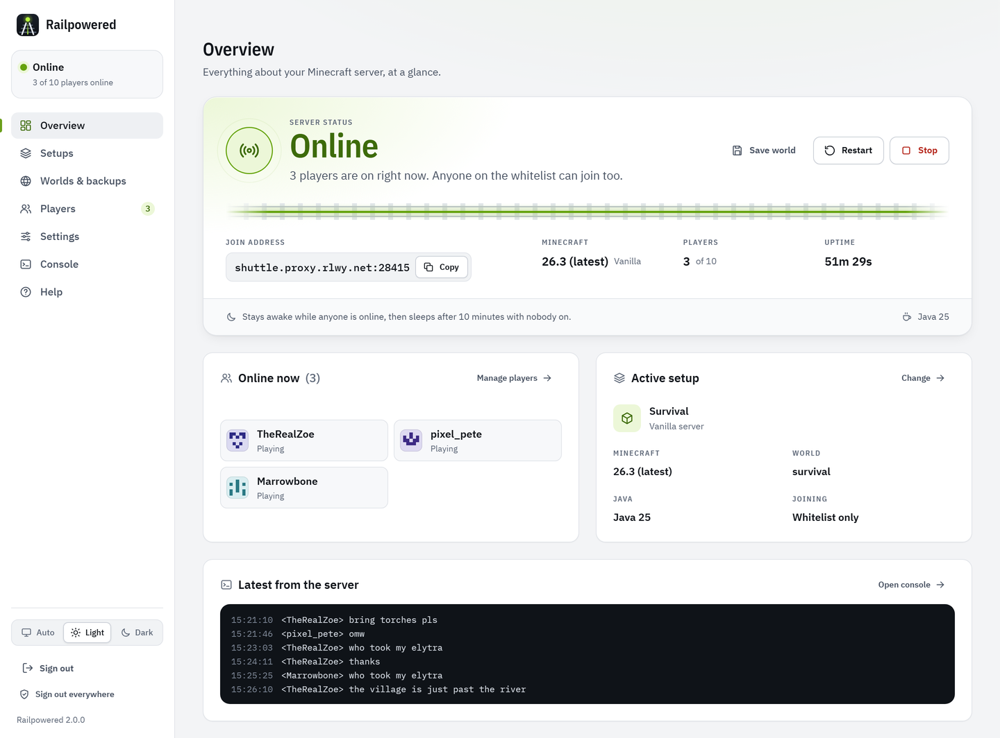
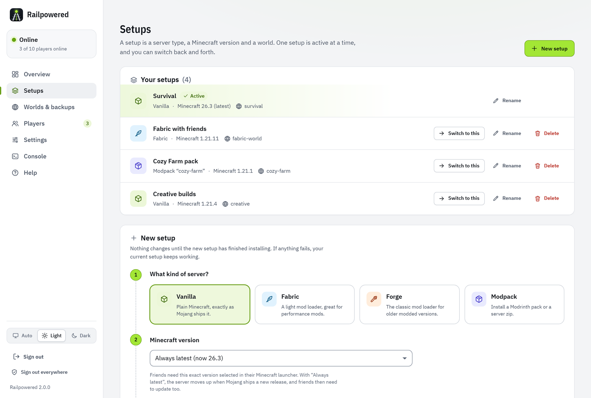
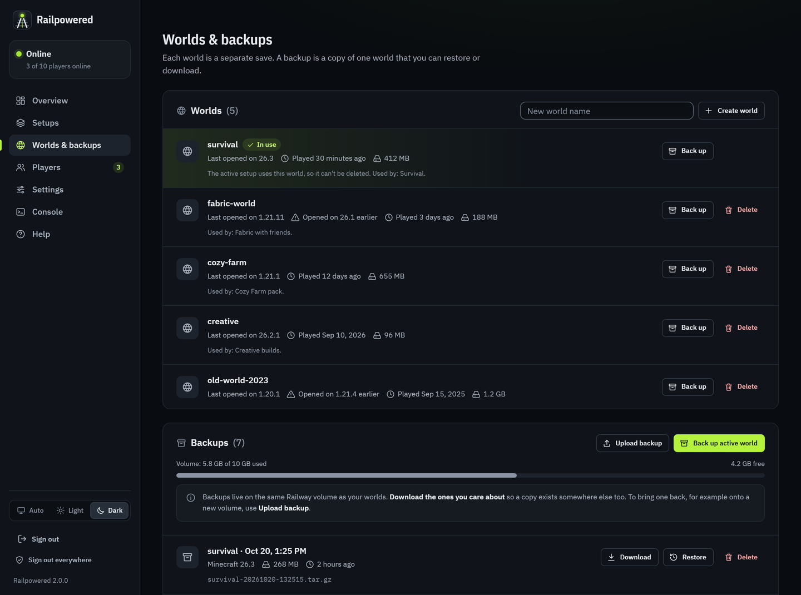
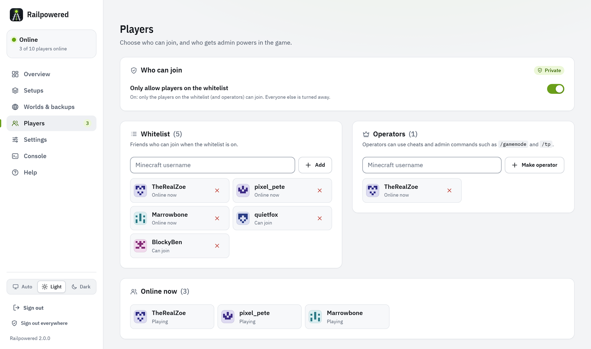
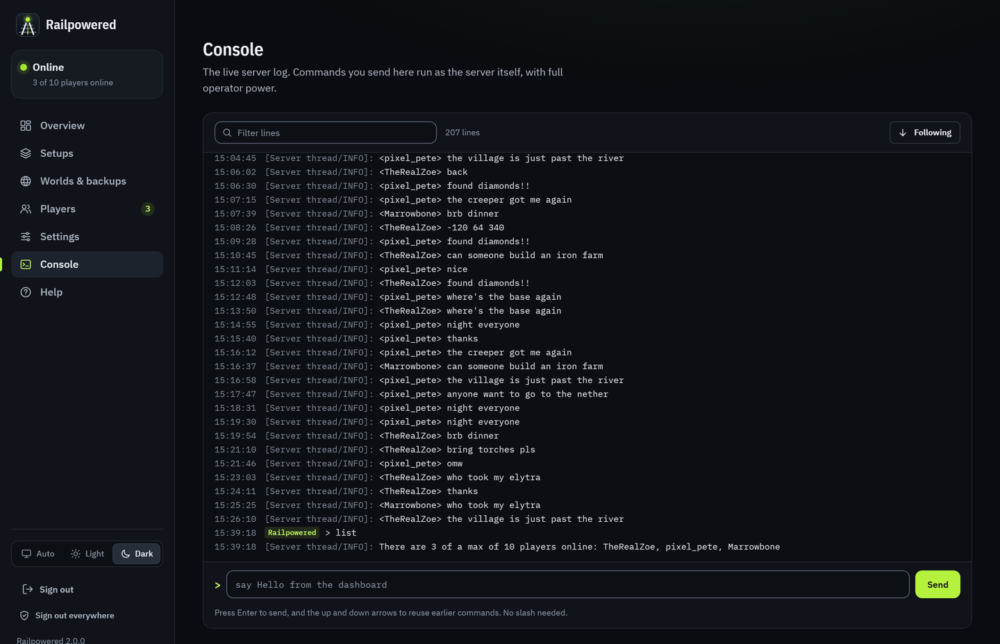
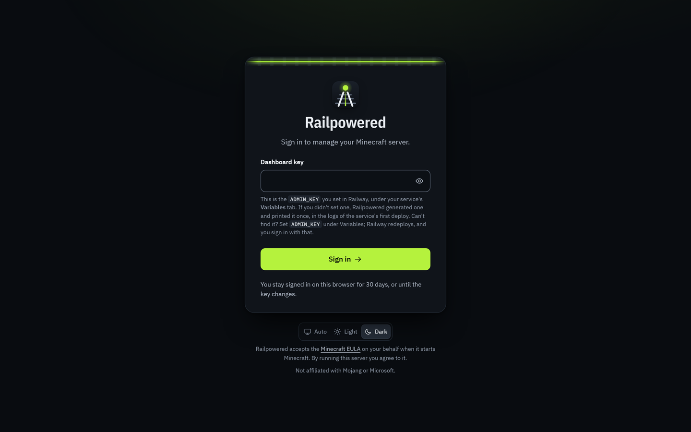
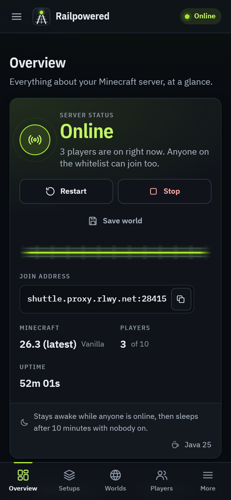
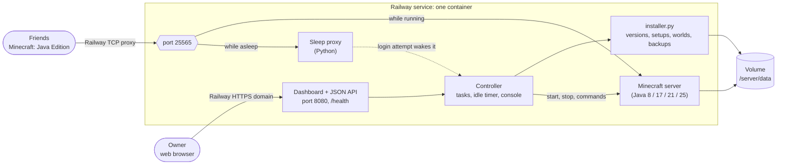
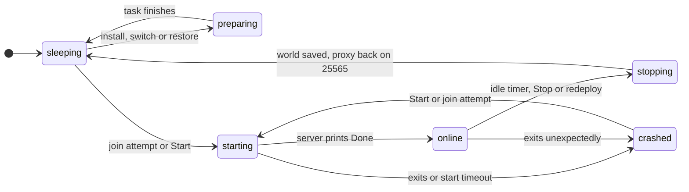

<div align="center">


# Railpowered

**A Minecraft Java server for your friends that sleeps when nobody's online and wakes up when someone joins.**<br>
One-click on Railway, with a dashboard for versions, modpacks, worlds, backups and players.

<a href="https://railway.com/new/template/railpowered?utm_medium=integration&utm_source=button&utm_campaign=railpowered"></a>

[](https://github.com/rndaom/Railpowered/actions/workflows/ci.yml)
[](LICENSE)
[](CONTRIBUTING.md)
[](https://railway.com/new/template/railpowered?utm_medium=integration&utm_source=button&utm_campaign=railpowered)

<picture>
  <source media="(prefers-color-scheme: dark)" srcset="docs/assets/screenshots/overview-dark.png">
  <source media="(prefers-color-scheme: light)" srcset="docs/assets/screenshots/overview-light.png">
  
</picture>

[Quick start](#quick-start) ·
[How it works](#how-it-works) ·
[Configuration](#configuration) ·
[Security](#security) ·
[FAQ](#faq-and-troubleshooting) ·
[Development](#local-development)

</div>

## What it is

Railpowered is a [Railway](https://railway.com) template that runs one Minecraft: Java Edition server for a group of friends. You deploy it once, set a dashboard password, and share the join address. Everything after that happens in a web dashboard: no SSH, no config files, no mod-loader installers.

When nobody has been online for a while, Railpowered saves the world and stops Minecraft. A small Python process keeps listening on the Minecraft port, and when a friend tries to join it starts the server again. The Java process, which is what uses most of the memory and CPU, only runs while people are playing.

The whole manager (sleep proxy, dashboard, installer) is written in Python with **only the standard library**, so the image has no third-party Python packages to audit or update.

## Features

**Server**

- **Wake on join.** While asleep, a sleep proxy owns port 25565. It answers the server list with your real MOTD and version, and a real login attempt wakes the server. A server-list ping never does. If a wake ends with nobody actually joining (a scanner, or a friend who gave up), joins stop waking the server for 15 minutes, then for an hour after each further empty wake; a player joining or a press of **Start** ends the pause.
- **Sleep when empty.** After 10 minutes with nobody online (configurable, or off), Minecraft saves and stops.
- **Start, stop, restart, save** from the dashboard, plus a live log and a **console** for server commands.
- **Graceful shutdown on redeploy.** `SIGTERM` runs `save-all flush` and `stop` inside Railway's 60-second draining window.

**Setups: any version, any loader**

- A *setup* is a server type, a Minecraft version and a world. Save as many as you like and switch between them. One is active at a time.
- **Vanilla:** every release from 1.2.5 to the newest, or `latest`, which follows new releases.
- **Fabric:** every stable Fabric game version, with the newest stable loader (or a pinned one).
- **Forge:** 1.16.5, 1.12.2 and 1.7.10, using curated recommended builds.
- **Modpacks:** a Modrinth `.mrpack` or a server `.zip`, from a link or uploaded from your computer (Fabric or Forge packs).
- **Java picked for you.** The image ships Eclipse Temurin 8, 17, 21 and 25. Railpowered reads the Java requirement from Mojang's version metadata and uses the smallest Java that fits.
- **Installs are transactional.** A new setup installs first and becomes active only if that succeeds. If it fails, your current setup keeps working.
- **Downloaded files.** The Setups page lists the server jars, Fabric and Forge installs and modpacks on the volume, with their sizes. Delete the ones no setup uses to free space. A setup that needs them later downloads them again.

**Worlds and backups**

- Multiple worlds side by side. Each one remembers the newest Minecraft version that opened it.
- **Downgrade guard.** Opening a world with an older version than it was played on is blocked, whether that comes from a new setup, a setup switch, a modpack install or a start after a restore. The dashboard asks first: pick a new world instead, or confirm, in which case a backup is taken first.
- **Backups** of one world as a `.tar.gz`. Backups of a running world use `save-off` / `save-all flush` / `save-on`, so the server stays online. Restore into the same world or a new one, download any backup, and bring one back with **Upload backup**.
- **Automatic safety backups** before a restore, a downgrade and a world upgrade.

**Players and settings**

- Manage **operators** and the **whitelist** (names are resolved to Mojang UUIDs), and turn the whitelist on or off without a restart. While the whitelist is on, joins from players who aren't on it don't wake the server.
- Edit **server settings** (MOTD, difficulty, game mode, hardcore, PvP, max players, view and simulation distance, spawn protection, flight, Nether, seed, world type, online mode, command blocks) plus the sleep timer and start-on-deploy. Keys you don't edit in the dashboard are left alone.

**Dashboard**

- Signed, revocable sessions, plus **Sign out everywhere** to end them all at once. CSRF protection on every change. Rate-limited sign-in. A strict Content Security Policy.
- No third-party requests: the IBM Plex fonts and every icon are served by the dashboard itself.
- Light, dark and automatic themes, keyboard accessible, with a mobile layout that has a bottom tab bar.

<table>
  <tr>
    <td width="33%" align="center">
      <picture>
        <source media="(prefers-color-scheme: dark)" srcset="docs/assets/screenshots/setups-dark.png">
        <source media="(prefers-color-scheme: light)" srcset="docs/assets/screenshots/setups-light.png">
        
      </picture>
      <br><sub><b>Setups</b>: vanilla, Fabric, Forge or a modpack</sub>
    </td>
    <td width="33%" align="center">
      
      <br><sub><b>Worlds &amp; backups</b>: restore, download, upload</sub>
    </td>
    <td width="33%" align="center">
      
      <br><sub><b>Players</b>: whitelist and operators</sub>
    </td>
  </tr>
  <tr>
    <td width="33%" align="center">
      
      <br><sub><b>Console</b>: live log and commands</sub>
    </td>
    <td width="33%" align="center">
      
      <br><sub><b>Sign-in</b>: rate-limited, one key</sub>
    </td>
    <td width="33%" align="center">
      
      <br><sub><b>Mobile</b>: bottom tab bar</sub>
    </td>
  </tr>
</table>

## Quick start

1. **Click [Deploy on Railway](https://railway.com/new/template/railpowered?utm_medium=integration&utm_source=button&utm_campaign=railpowered).**
2. **Keep or replace `ADMIN_KEY`** on the Deploy form. This is your dashboard password. The template fills in a random 32-character key (you can read it later in the service's Variables); if you type your own, make it a long passphrase (four or more random words, or 20+ characters). Anyone who has it controls the server.
3. **Deploy.** The template creates one service with a volume at `/server/data`, a TCP proxy for Minecraft and a public HTTPS domain for the dashboard. The dashboard comes up within seconds, and the first Minecraft download runs in the background.
4. **Open the service's public URL** and sign in with your `ADMIN_KEY`.
5. **Copy the join address** from the Overview (it comes from Railway's TCP proxy and looks like `something.proxy.rlwy.net:12345`) and send it to your friends.

That's it. Pressing **Start** is optional: the first friend who joins wakes the server. If you'd rather keep it running from the moment it deploys, turn on *Start on deploy* in Settings.

> [!NOTE]
> **Minecraft EULA.** Running a Minecraft server requires accepting the [Minecraft End User License Agreement](https://www.minecraft.net/eula). Railpowered writes `eula=true` for you so the server can start. **By deploying or running Railpowered, you agree to the Minecraft EULA.** The dashboard footer says the same.

## How friends join

1. Open **Minecraft: Java Edition** and pick the **same version** the dashboard shows. Versions have to match exactly. Bedrock (console and phone) can't join.
2. **Multiplayer → Add Server**, then paste the join address, including the `:port` part.
3. **Join.** If the server is asleep, the first attempt shows *"The server is waking up! Try joining again in a minute."* Wait while it starts, then join again. A vanilla server usually needs well under a minute; big modpacks and the very first start, which downloads Minecraft, take longer.

The server list shows *"Sleeping - join to wake it up"* under the MOTD. Refreshing the list never wakes the server. Only a login attempt does.

## How it works

One Railway service runs one container. Inside it, a single Python process (`manager.py`) runs the dashboard, the sleep proxy and the controller that starts and stops Minecraft as a child process.



- **Port 25565 always has an owner.** Whenever Minecraft is not running, including while something installs, the sleep proxy holds the port. It hands the port over just before the JVM starts and takes it back after every stop, crash or failed start.
- **The sleep proxy** speaks just enough of the Minecraft protocol: modern (1.7+) status and ping, the 1.4–1.6 and older legacy pings, and the login handshake for both protocol families. It reads every connection with a hard deadline and size limits, caps concurrent connections, and drains the socket before closing so the player actually sees the kick message.
- **The dashboard** is a `ThreadingHTTPServer` serving `web/` (plain HTML, CSS and JavaScript, no build step) and a JSON API. `/health` answers without signing in, for Railway's health check. The HTTP server starts *before* any downloads, so the first deploy passes the health check right away.
- **Long jobs run as tasks.** Installs, setup switches, modpacks, backups and restores run one at a time in the background. The dashboard shows their progress, and while one runs the proxy answers joins with *"Server is updating, try again in a minute."*

### Server phases



| Phase | Meaning |
|---|---|
| `sleeping` | Minecraft is down. The sleep proxy owns 25565, and a login wakes it (unless wakes are paused after an empty wake; the Overview then shows when joins wake it again). |
| `preparing` | A background task is installing or downloading. Joins are told to try again shortly. |
| `starting` | The JVM is up but hasn't finished loading the world. |
| `online` | Minecraft printed `Done (…)`, so players can join. The idle timer runs while nobody is online. |
| `stopping` | `save-all flush`, then `stop`, with a grace period before the process is killed. |
| `crashed` | The process exited unexpectedly or didn't finish starting within `START_TIMEOUT`. The proxy is back on the port, and the Overview shows the last meaningful log line. After a failed *start*, joins don't retry for 5 minutes, or at all for errors a retry can't fix, such as a missing Java or a blocked downgrade. The Overview says which applies and when a join will wake the server again. |

## Costs and sleeping on Railway

Railway bills by resource usage. See [Railway's pricing](https://railway.com/pricing) for current rates and what each plan includes. What Railpowered changes is *how much* it uses:

- **While asleep**, the Minecraft JVM is stopped, so its memory and CPU use drop away. What's left is the small Python manager keeping the dashboard and the sleep proxy up.
- **The container and the volume still exist while asleep.** Railpowered doesn't rely on Railway's own service sleeping, because something has to listen for the next join. Volume storage, including worlds, downloaded server files and backups, is billed whether the server is awake or not.
- **The sleep timer** defaults to 10 minutes with nobody online. Set it from 1 minute to one day in Settings, or 0 to never sleep. It only counts while the server is online and empty, so a server you start and nobody joins also goes back to sleep.
- The template requests a **5 GB volume**. Railway caps volume size by plan, so a plan with a smaller limit gets that limit. The Worlds page shows how much space is used and free.

## Configuration

Most settings live in the dashboard and are stored on the volume. Railway variables cover the dashboard password, first-boot defaults and a few advanced limits. Bad values never crash the server: they fall back to the default, and a warning appears in the log.

**Set on the Deploy form**

| Variable | Default | What it does |
|---|---|---|
| `ADMIN_KEY` | *required* | Dashboard password. Use a long passphrase. Changing it signs everyone out. If it's unset, a random key is generated, saved on the volume (`.admin-key`) and printed **once** in the deploy log. A weak key (shorter than 12 characters, fewer than 5 different characters, or a well-known password) is refused: the key on the volume is used instead, the deploy log says so loudly and the dashboard shows a banner until you fix it. |
| `ALLOW_WEAK_ADMIN_KEY` | `false` | `1` accepts a weak `ADMIN_KEY` anyway (not recommended). |
| `TOTP_SECRET` | *unset* | Optional second sign-in factor. A base32 secret (16+ characters) shared with an authenticator app; the sign-in page then also asks for its 6-digit code. See [Security](#security). |
| `PORT` | `8080` | Dashboard port. Keep `8080` so Railway's health check and HTTP domain reach it. Ignored if it equals 25565. |
| `MINECRAFT_VERSION` | `latest` | **First boot only:** the version of the first setup (`latest`, or a version such as `1.21.1`). After that, change versions from the Setups page. A later change is noted in the log and otherwise ignored. |
| `SERVER_TYPE` | `vanilla` | **First boot only:** `vanilla`, `fabric` or `forge`. Forge needs `MINECRAFT_VERSION` set to `1.16.5`, `1.12.2` or `1.7.10`. Add modpacks from the dashboard. |
| `AUTO_START` | `false` | Start Minecraft when the container boots instead of waiting for a join. **The dashboard's *Start on deploy* setting overrides it once saved.** |
| `IDLE_TIMEOUT` | `600` | Seconds with nobody online before Minecraft sleeps. `0` means never, the maximum is `86400` (one day), and values from 1 to 59 become 60. **The dashboard's sleep timer overrides it once saved.** |
| `MC_MAX_MEMORY` | `auto` | Java heap limit (`-Xmx`): `auto`, or a size such as `1536M` or `3G` (at least `128M`). See *Memory and performance* below. |
| `MC_MIN_MEMORY` | `256M` | Java heap reserved at start (`-Xms`). If it's larger than the maximum, the maximum is used. |

<details>
<summary><strong>Advanced variables</strong></summary>

<br>

| Variable | Default | What it does |
|---|---|---|
| `MC_PUBLIC_ADDRESS` | *unset* | Join address shown in the dashboard. Overrides the one built from `RAILWAY_TCP_PROXY_DOMAIN` and `RAILWAY_TCP_PROXY_PORT`, which Railway sets for you. |
| `START_TIMEOUT` | `900` | Seconds a start may take before Minecraft is stopped and reported as crashed. `0` disables the limit. Otherwise it's at least `120` and at most `21600`. |
| `STOP_TIMEOUT` | `30` | Seconds Minecraft gets to save and exit before it's killed (5 to 45, so a shutdown fits Railway's 60-second draining window). |
| `BACKUP_KEEP` | `0` | How many *automatic* backups (pre-restore, pre-downgrade, pre-upgrade) to keep per world. `0` keeps all. Manual and uploaded backups are never pruned. |
| `MAX_UPLOAD_MB` | `1024` | Largest modpack or backup upload, and largest modpack download. |
| `MAX_EXTRACT_MB` | `8192` | Largest unpacked modpack. Free space on the volume also limits it. |
| `FABRIC_LOADER_VERSION`, `FABRIC_INSTALLER_VERSION` | *unset* | Pin Fabric's loader and installer instead of using the newest stable ones. |
| `WEB_PORT` | *unset* | Dashboard port. Takes precedence over `PORT`. Ignored if it equals 25565. |
| `JAVA_8_HOME`, `JAVA_17_HOME`, `JAVA_21_HOME`, `JAVA_25_HOME` | `/opt/java/<n>` | Where each Java runtime lives. The image sets these. Locally, set the ones you have. Railpowered falls back to `java` on `PATH`. |
| `WEB_DIR` | `/server/web` | Where the dashboard files are served from. Falls back to the repository's `web/`. |
| `MC_DIR` | `/server/data` | Data directory. Set it when running locally. In the container, the volume is mounted here. |

The values come from [`mc_host/config.py`](mc_host/config.py) and [`installer.py`](installer.py). The template's own variable descriptions are in [`.railway/README.md`](.railway/README.md).

</details>

<details>
<summary><strong>What's stored on the volume</strong></summary>

<br>

Everything Railpowered writes lives in `/server/data`, so it survives redeploys:

| Path | Contents |
|---|---|
| `manager.json` (+ `.bak`) | Saved setups, the active setup, and dashboard settings (sleep timer, start on deploy). Written atomically. |
| `server.properties` | Canonical Minecraft settings. Railpowered only rewrites the keys it owns (`server-port`, `server-ip`, `level-name`, and `online-mode` on 1.6.4 and older). Everything else you set is kept. |
| `ops.json`, `whitelist.json` | Canonical player lists. 1.7.5 and older use `ops.txt` / `white-list.txt`. In-game `/op` and `/whitelist` changes are synced back. |
| `worlds/<name>/` | One folder per world, with a `.railpowered.json` sidecar recording the newest version that opened it. |
| `instances/<name>/` | Fabric, Forge and modpack server folders. |
| `jars/`, `cache/`, `modpacks/` | Vanilla server jars and loader installers, cached Mojang and Fabric metadata, and modpack downloads. |
| `backups/` | `<world>-<YYYYmmdd-HHMMSS>.tar.gz` archives, each with a `railpowered-backup.json` inside. |
| `.admin-key`, `.session-secret`, `.session-revoked.json` | The generated dashboard key (only if `ADMIN_KEY` is unset), the session-signing secret and revoked sessions. |
| `.uuid-cache.json`, `eula.txt` | Mojang name-to-UUID lookups, and the EULA acceptance. |

</details>

<details>
<summary><strong>Memory and performance</strong></summary>

<br>

- **Heap.** With `MC_MAX_MEMORY=auto`, the heap uses at most 2 GiB and leaves room for Java's native memory in smaller containers. In a 1 GiB container it comes to about 700 MiB, which is not enough for a busy modern world. Set `MC_MAX_MEMORY` explicitly if your world or modpack needs more, and keep it below the service's memory limit. G1GC is used unless the server's own launch arguments choose a collector.
- **New worlds** start with an 8-chunk view distance and a 6-chunk simulation distance. These are conservative defaults for a small shared server. Change them in Settings. A shorter simulation distance means fewer chunks tick around each player, but farms and mobs stay active over a shorter range.
- **If play feels slow**, separate server lag (delayed blocks or mobs) from slow joining or low client FPS. Check Railway's CPU and memory graphs and the console for `Can't keep up` or out-of-memory errors. On vanilla 1.20.3 and newer, `tick query` in the console shows the tick rate. Measure while the lag is happening before you change versions.

</details>

<details>
<summary><strong>Supported versions</strong></summary>

<br>

| Type | Versions | Java |
|---|---|---|
| Vanilla | Every release from **1.2.5** to the newest, from Mojang's version manifest (no snapshots). `latest` follows new releases. | From Mojang's `javaVersion`. The fallback is 8 below 1.17, 17 up to 1.20.4, 21 up to 1.21.x, and 25 for 26.x. |
| Fabric | Every stable Fabric game version. `latest` follows new releases. | Same as vanilla |
| Forge | 1.16.5 (36.2.39), 1.12.2 (14.23.5.2859), 1.7.10 (10.13.4.1614) | 8 |
| Modpack | Modrinth `.mrpack` or server `.zip` with a Fabric or Forge loader. A pack's own Forge version is honoured. NeoForge and Quilt packs aren't supported yet. | Chosen from the pack's Minecraft version |

- 1.0 to 1.2.4 never had an official server download, so they aren't offered.
- 1.6.4 and older always run in offline mode, because Mojang's old login servers are gone. Railpowered sets this for you and restores your choice when you switch back to a modern version.
- 1.7 to 1.18.0 get Mojang's documented Log4Shell mitigations automatically.
- When `latest` can't reach Mojang, Railpowered uses the newest server already on the volume, so waking the server doesn't depend on Mojang being up.

</details>

## Security

The dashboard sits on a public URL and the join address is easy to scan for. Railpowered's protections:

- **Sessions:** signed `HttpOnly` cookies (`__Host-` prefixed and `Secure` over HTTPS, `SameSite=Lax`) that last 30 days. They're keyed to a secret on the volume plus `ADMIN_KEY`, so changing the key signs everyone out. Signing out revokes the session for good, even across restarts, and **Sign out everywhere** (in the sidebar) revokes every session at once, this browser's included.
- **CSRF:** every state-changing API request must carry the `X-Railpowered: 1` header and pass a same-origin check.
- **Sign-in limits:** 10 failed attempts per address per 10 minutes. Past 60 failures from all addresses, sign-ins go through a slow lane: one key check every 3 seconds, at most two waiting, and everyone else is told "Too many attempts" at once. A wait that times out counts as a failure. During such a flood new sign-ins may be refused, but browsers that are already signed in keep working: some connections are kept for requests with a valid session (and some for `/health`). The key is compared in constant time.
- **Optional authenticator codes:** set `TOTP_SECRET` and the sign-in page also asks for a 6-digit code from an authenticator app (RFC 6238: SHA-1, 30-second steps; the previous and next code are accepted for clock drift, and each code works once). A wrong key and a wrong code read the same and count the same toward the limits. If `TOTP_SECRET` isn't a valid base32 secret, every sign-in is refused (and the deploy log says why) rather than quietly dropping the second factor.
- **Headers:** a strict Content Security Policy (no inline scripts), `X-Frame-Options: DENY`, `nosniff`, `Referrer-Policy: same-origin`, and `Cache-Control: no-store` on API responses.
- **Least privilege:** Minecraft and the manager run as an unprivileged `minecraft` user. `ADMIN_KEY` and other secrets are removed from the JVM's environment. Names of worlds, setups and packs are validated, and every delete is checked to stay inside the volume. Modpack downloads are limited to public addresses, with size limits on downloads and extraction.

**What you should do:**

- Use a **long `ADMIN_KEY`**, and keep Railway variables and logs private.
- For a **second factor**, create a secret with `python3 -c "import base64,os; print(base64.b32encode(os.urandom(20)).decode())"`, add it to your authenticator app (manual entry, time-based), then set it as `TOTP_SECRET` in the service's Variables. Removing the variable turns the second factor off again.
- **Turn on the whitelist** (Players page) for a private server. Without it, anyone with a Minecraft account who finds the address can join.
- **Keep online mode on.** With it off, anyone can join under any name, an operator's included. Old versions (1.6.4 and older) always run offline, so use the whitelist there.
- **Only install mods and modpacks you trust.** They run with the same permissions as the dashboard.

See [SECURITY.md](SECURITY.md) for the full guidance and how to report a vulnerability privately.

## Backups and safe version changes

Minecraft can upgrade a world to a newer version, but it can't take it back. Railpowered is built around that:

- **New version, new world** is the default when you create a setup. You can reuse an existing world instead.
- **Upgrades are backed up automatically.** Before a world opens on a newer version than before, including when `latest` moves to a new release, a `pre-upgrade` backup is taken.
- **Downgrades are blocked.** If a setup would open a world on an older version than it was played on, Railpowered refuses with a clear message. You can pick a newer version, use a new world, or confirm, which takes a `pre-downgrade` backup first.
- **Restoring replaces one world** and first saves a `pre-restore` backup of it as it is now. Restoring never touches setups, settings or player lists. You can also restore into a new world name.
- **Live backups** of the running world pause autosaves (`save-off`), flush to disk (`save-all flush`), archive, then resume (`save-on`), so the server stays online.
- **Keep a copy elsewhere.** Backups live on the same Railway volume as the worlds, so deleting the volume deletes them too. Download the ones you care about. **Upload backup** on the Worlds page brings a downloaded backup back later, for example onto a new volume.

## FAQ and troubleshooting

<details>
<summary><strong>Do I need to press Start?</strong></summary>

<br>No. The first friend who tries to join wakes the server. Start is there if you want it running before anyone joins. To start it with every deploy, turn on <em>Start on deploy</em> in Settings, or set <code>AUTO_START=true</code>.
</details>

<details>
<summary><strong>The join address is empty</strong></summary>

<br>Railway gives the server a public address through a <strong>TCP proxy</strong> on port <code>25565</code>. The template adds one. If you deployed another way, open the service in Railway, go to <strong>Settings → Networking</strong> and add a TCP proxy for port <code>25565</code>. The address appears after the next deploy. You can also set <code>MC_PUBLIC_ADDRESS</code>.
</details>

<details>
<summary><strong>A friend sees "Outdated client" or "Outdated server"</strong></summary>

<br>Their launcher version must match the server exactly. In the Minecraft launcher, open <strong>Installations</strong>, create one for the version shown on the dashboard, and play with that.
</details>

<details>
<summary><strong>Joining just says the server is waking up</strong></summary>

<br>That's expected on the first attempt. The sleep proxy can't hand your connection over to a server that isn't running yet. Wait until the dashboard shows <em>Online</em>, usually under a minute for vanilla, then join again. If the whitelist is on, only players on it (and operators) can wake the server.
</details>

<details>
<summary><strong>I forgot the dashboard key</strong></summary>

<br>If you set <code>ADMIN_KEY</code>, it's in the service's <strong>Variables</strong> on Railway. If you didn't, Railpowered generated one and printed it once in the first deploy's log. Either way, setting <code>ADMIN_KEY</code> in Variables replaces the key. Railway redeploys, and every existing session is signed out.
</details>

<details>
<summary><strong>The server crashed or won't start</strong></summary>

<br>The Overview shows the last meaningful line Minecraft printed, and the Console has the full log. Out-of-memory errors usually mean the world or modpack needs more heap than the container allows: raise the service's memory and <code>MC_MAX_MEMORY</code>. A start that hangs past <code>START_TIMEOUT</code> (15 minutes by default) is stopped and reported as crashed.
</details>

<details>
<summary><strong>Can I use my existing world?</strong></summary>

<br>Yes. Pack the world folder (the one with <code>level.dat</code>) as a <code>.tar.gz</code>, upload it with <strong>Upload backup</strong> on the Worlds page, then restore it into a new world. A world found at <code>/server/data/world</code> (for example from another server image) is left untouched, and a log message explains how to move it into <code>worlds/</code>.
</details>

<details>
<summary><strong>Why did my server go to sleep while I was starting it?</strong></summary>

<br>It didn't: the idle timer only counts once the server is <em>online</em> and empty. A server you start that nobody joins goes back to sleep after the timer runs out. Turn the timer off (0) in Settings if you want it always on.
</details>

## Local development

You need **Python 3.12** (3.13 is also tested). There's nothing to `pip install`. Java is only needed to run a real Minecraft server outside Docker.

```bash
# Run the real manager against a scratch data folder
MC_DIR="$PWD/data" ADMIN_KEY="dev-only-passphrase" PORT=8080 python3 manager.py
# then open http://localhost:8080; Minecraft clients can join localhost:25565

# Work on the dashboard without Java or Minecraft: a mock API with realistic state
python3 tools/mock_server.py            # http://127.0.0.1:8765, key "admin"
python3 tools/mock_server.py --no-auth  # skip the sign-in page

# Tests (standard library only, no network)
python -m unittest discover -s tests

# The same image Railway builds
docker build -t railpowered .
docker run --rm -it -p 8080:8080 -p 25565:25565 \
  -e ADMIN_KEY="dev-only-passphrase" -v railpowered-data:/server/data railpowered
```

**CI** ([`ci.yml`](.github/workflows/ci.yml)) runs the unit tests on Python 3.12 and 3.13 on Linux and 3.12 on Windows. It also lints (compileall, ShellCheck, actionlint, `node --check`, hadolint, `railway.toml` parsing) and builds and smoke-tests the Docker image.

**End-to-end** ([`e2e.yml`](.github/workflows/e2e.yml), [`tests/e2e/`](tests/e2e)) boots the image on Linux the way Railway runs it and plays it through over the real protocols. It covers sign-in and CSRF, the sleep proxy's modern and 1.6 pings, start, a live backup, stop, wake on join, a Fabric setup on a new world while online, switching back, the idle timer, a `SIGTERM` with Minecraft online (`docker stop -t 60` must exit cleanly), and a redeploy on the same volume.

Fabric, Forge and modpack setups link world folders with symlinks. On Windows that needs Developer Mode or WSL, so run those setups in Docker. See [CONTRIBUTING.md](CONTRIBUTING.md) for the full developer guide.

## Project structure

```
manager.py            Entry point: python3 manager.py
installer.py          Versions, Java, Fabric/Forge/modpack installs, setups, worlds,
                      backups, players and server.properties on the volume
mc_host/
  main.py             Boot and shutdown: dashboard first, then proxy, then background prepare
  config.py           Environment variables, ports, memory sizing, admin key
  auth.py             Signed sessions, revocation, sign-in rate limits
  panel.py            Dashboard HTTP server and JSON API
  web.py              Static files and security headers (CSP)
  tasks.py            Background tasks, one at a time
  process.py          Minecraft lifecycle: phases, start/stop, console, idle sleep, wake
  proxy.py            Sleep proxy on 25565 (modern and legacy protocols)
  installer_api.py    Adapter between the runtime and installer.py
  state.py            Shared server state and the log buffer
web/                  Dashboard: HTML, CSS, JavaScript, no build step
tools/mock_server.py  Dashboard with a fake API, for UI work and screenshots
tests/                unittest suite; tests/e2e/ drives a real container
server.properties     Defaults copied to a new volume
start.sh              Container entrypoint: seeds the volume, accepts the EULA, drops root
Dockerfile            Ubuntu 24.04, Python 3.12, Temurin 8/17/21/25 (SHA-256 pinned)
railway.toml          Railway build and deploy settings (health check, 60 s draining)
.railway/             Template notes and a reference IaC definition
.github/              CI, end-to-end, weekly JRE update check, issue templates
docs/assets/          Logo and screenshots
```

## Contributing

Bug reports, fixes and ideas are welcome. Please read [CONTRIBUTING.md](CONTRIBUTING.md) first. For anything large, open an issue so we can agree on the approach. Report security problems privately as described in [SECURITY.md](SECURITY.md).

## License and credits

Railpowered is released under the [MIT License](LICENSE). See [NOTICE](NOTICE) for third-party notices.

- **Minecraft** is a trademark of Mojang AB. Railpowered is not an official Minecraft product and is not approved by or associated with Mojang or Microsoft. It doesn't include or redistribute Minecraft: server software is downloaded at runtime from its official sources.
- **[Eclipse Temurin](https://adoptium.net/)** Java runtimes from the Eclipse Adoptium project (GPLv2 with the Classpath Exception) are included in the Docker image.
- **[Fabric](https://fabricmc.net/)** and **[Minecraft Forge](https://minecraftforge.net/)** are downloaded from their official Maven repositories when you choose them.
- **[Modrinth](https://modrinth.com/)** hosts the `.mrpack` modpack format and most modpacks you'll install.
- **[IBM Plex](https://github.com/IBM/plex)** fonts (SIL Open Font License 1.1) are bundled with the dashboard in [`web/assets/fonts/`](web/assets/fonts).
